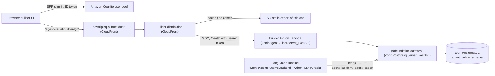
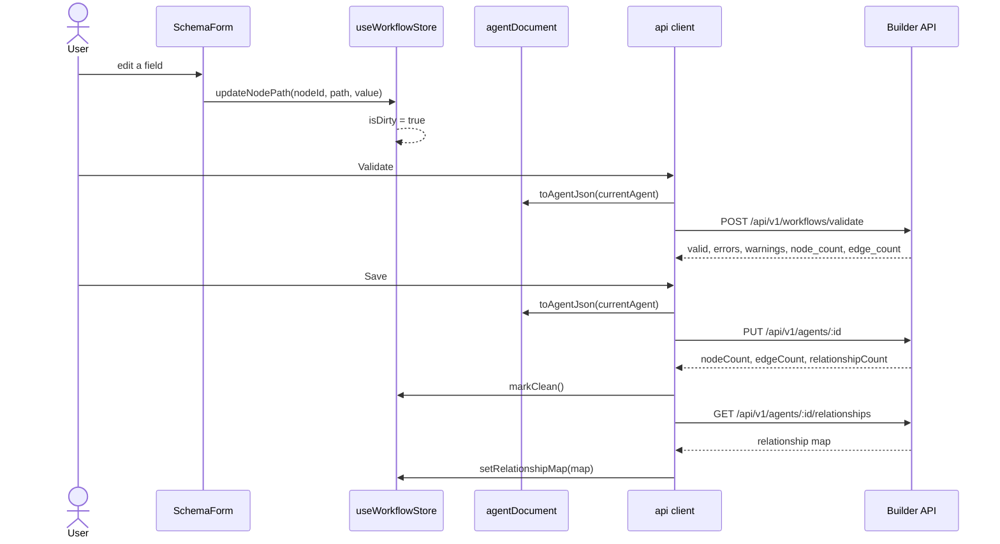

# Technical design: Zonic Agent Builder — UI (Next.js) V2

How this repository is built. Setup, commands and the hackathon summary are in the [README](../README.md).

The builder edits one JSON document, an agent workflow of nodes and edges. It
loads the document from the builder API, edits it in a Zustand store and saves
it back whole. It knows no node types of its own: the palette, the canvas
cards, the handles and every properties form come from the API's node
registry. The LangGraph runtime later reads the saved document and runs it; the
platform-wide architecture is in the
[runtime's README](https://github.com/TripleQAI/ZonicAgentRuntimeBackend_Python_LangGraph).

| Layer | Choice |
|---|---|
| Framework | Next.js 15 App Router, React 19, TypeScript; deployed as a static export |
| Canvas | React Flow (`@xyflow/react` 12) |
| State | Zustand 5 + immer for the document; TanStack React Query 5 for server data |
| Forms | react-hook-form 7, driven by the registry's form schemas |
| Sign-in | Amazon Cognito through `aws-amplify` 6 (SRP) |
| Tests | Vitest 2, jsdom, Testing Library |

## Architecture

```
app/page.tsx           redirects to /workflows
app/workflows          WorkflowListPage: search, sort, 20 per page, import, new
app/login              LoginPage: Cognito sign-in, then back to ?next=
app/builder            route shell; ?id=<workflow> opens one, ?new=1 a blank one
  BuilderShell         owns load / save / export; everything else subscribes
    AppHeader          name, counts, breadcrumb, toolbar, agent explorer
    LeftSidebar        node palette, grouped by category (HTML5 drag source)
    FlowCanvas         React Flow: RegistryNode, ContainerNode, BendableEdge, minimap
    PropertiesPanel    resizable; SchemaForm or AgentSettingsPanel
    DialogHost         all modal and drawer surfaces

store/useWorkflowStore   Zustand + immer — the analogue of workflow_store.js
lib/api                  fetch client; one error envelope
lib/serialization        the raw_json overlay contract, both directions
lib/registry             palette groups, handle derivation, swarm containers
lib/runtime              mock engine + one executor per node type
lib/auth                 Cognito sign-in and the ID token
components/fields        FIELD_COMPONENTS registry — 26 widget types
```

[`BuilderShell`](../src/components/layout/BuilderShell.tsx) fetches the registry,
the node semantics and the workflow list, opens the workflow the URL names
(else the root or first workflow, else a blank one) and owns `save`. The
regions read the store through selectors, so the shell rarely re-renders.
`DialogHost` maps
each toolbar action to its dialog or drawer; the three exports fetch and
download instead.



The API stores the document through the pgfoundation gateway, and the runtime
reads it from the builder's `agent_builder` views through the same gateway. The
builder never calls the runtime.

## Registry-driven editing

**The registry drives everything.** `GET /api/v1/node-types` returns 18 node
types with their icons, colours, handles and form schemas. One `RegistryNode`
component renders all of them on the canvas (a swarm's frame is
`ContainerNode`), and one `SchemaForm` renders every properties panel. Adding a
node type is a backend JSON file — no component, no CSS, no switch statement.

On the server each type is one file under `app/resources/node_types/`. Shared
pieces live in `app/resources/fragments/`, and the loader inlines them wherever
a file says `{"$ref": "<fragment>"}`. Each entry ([`NodeTypeDef`](../src/types/registry.ts))
carries its palette `category`, a `defaultNamePrefix` and `defaultConfig` for
new nodes, static `handles`, `formSchema.sections`, and an optional
`layout.kind: "container"`. Three more resources complete the contract and are
fetched once per session:

| Endpoint | What it declares |
|---|---|
| `GET /api/v1/node-semantics` | Structural roles: `childReference` (Sub Flow), `handoffTargets` (Agent), `branches` (Rule), `swarms` (Swarm) |
| `GET /api/v1/option-sets` | Shared select lists: `nodeCategories`, `mappingTypes`, `messageRoles`, `invocationTypes` and more |
| `GET /api/v1/mcp-config-schema` | The MCP configurator's form, visibility and validation rules |

The palette groups node types by the `nodeCategories` option set, in its order
([nodeCategories.ts](../src/lib/registry/nodeCategories.ts)); a type with an
unknown category lands in the first group instead of disappearing.

**`field.key` is the form field name.** The schema declares dot-paths like
`config.model`; react-hook-form registers exactly that string. This is why the
1,760-line `dynamic_fields.js` becomes a short renderer plus small components
with a uniform `{field, name}` contract. [`SchemaForm`](../src/components/properties/SchemaForm.tsx):

1. Seeds the form from the node: the value at each field's dot-path, else its
   `defaultValue`, else an empty value for its widget type.
2. Renders each section, plain or accordion, and each field through
   `resolveFieldComponent(field.type)`.
3. Writes back only the paths whose value changed, one
   `updateNodePath(nodeId, path, value)` each, and skips the seeding pass so
   opening a node does not mark the workflow unsaved.
4. Rebuilds the sections when `config.rules`, `config.toolType` or
   `config.responseFormat` change, since those change the form's shape.

**The widget registry.** [`FIELD_COMPONENTS`](../src/components/fields/index.ts)
maps 26 field types to components: the 25 of the source's `_buildField` switch
plus `member_list` for swarms. An unknown type falls back to a text input.

| File | Widgets |
|---|---|
| `basic.tsx` | `text`, `textarea`, `number`, `switch`, `select`, `node_select`, `multi_select` |
| `editors.tsx` | `code`, `markdown`, `json`, `variable_reference`, `target_reference`, `expression`, `view_template` |
| `lists.tsx` | `key_value_list`, `message_list`, `mapping_list`, `state_update_list`, `tool_list`, `condition_builder`, `schema_builder`, `query_var_list` |
| `handoff.tsx`, `members.tsx`, `relations.tsx` | `node_multiselect`, `member_list`, `agentic_workflow_selector`, `relationship_status` |

List widgets use `useFieldArray` and register each cell at a nested path,
`${name}.${index}.${column.key}` (for example `config.messages.0.content`), so
a row edit is still one dot-path patch. Two widgets write to the store instead
of the form, because what they edit is also on the canvas: the handoff editor
(`node_multiselect`) and the swarm member list.

With no node selected, the panel shows
[`AgentSettingsPanel`](../src/components/properties/AgentSettingsPanel.tsx), which
edits the workflow itself through `patchAgent`: names, BPC, description,
invocation type, four flags, and JSON editors for `variables`, `interface`,
`skills`, `publishChannels` and `security`.

**Model choice.** The UI holds no model list. The Agent and LLM node types
declare `config.model` as a required `select` with options
`{"$ref": "options.models"}`, which the server fills from
`app/resources/fragments/options.models.json`:

| Values | Family |
|---|---|
| `nemotron-3-ultra`, `nemotron-3-super`, `nemotron-3-nano`, `nemotron-3.5-super-vl` | NVIDIA Nemotron, served by Nebius Token Factory |
| `claude-opus-4-8`, `claude-sonnet-4-6`, `claude-haiku-4-5` | Anthropic Claude |

The chosen code is saved as a plain string at `config.model`, and the runtime
maps it to a provider model in its `resources/models.json`. A swarm's members
are Agent and LLM nodes, so each member picks its own model. Adding a model is
a one-line edit to the fragment, with no UI release.

## State and data flow

React Query holds what the server owns: registry, semantics, option sets, tools
and the workflow list, with `refetchOnWindowFocus: false` so a refetch never
fights the unsaved-changes flag. One Zustand store
([useWorkflowStore.ts](../src/store/useWorkflowStore.ts)) holds what the user is
editing: `currentAgent` (the draft), the selection, the registry and semantics
for synchronous lookups, the relationship map, and the flags `isDirty`,
`isReadOnly` and `formEpoch`. The immer middleware lets actions mutate a draft
while the store stays immutable. Every mutating action sets `isDirty`, which
replaces the source's jQuery `workflow-dirty` event, and bumping `formEpoch`
remounts the properties form when the selection changes or a dialog writes a
value the form also holds.



Validation is a separate call and does not block a save. On save the server
upserts the document and derives the parent–child relationships from its nodes
in one transaction.

**Serialization.** [agentDocument.ts](../src/lib/serialization/agentDocument.ts)
holds the `raw_json` overlay contract, both directions and nowhere else.
`fromAgentJson` copies the document into first-class draft fields, drops each
node's stale `data` key (React Flow owns it) and keeps the whole original as
`rawJson`. `toAgentJson` starts from a deep copy of `rawJson` and overlays the
draft's fields, so keys the editor does not model (`originalBpc`,
`freezeRelease`, `createdBy`, or anything a future producer adds) survive the
round trip. On load, `repairContainers` also makes each swarm member's
`parentId` agree with the swarm's members list; the list wins, as the runtime
reads it.

**The API client.** [client.ts](../src/lib/api/client.ts) is one `request<T>()`
behind a typed `api` object. It attaches the Cognito ID token as
`Authorization: Bearer` on every call. The server answers every failure with
one envelope, `{error, code, traceId}`, which becomes an
`ApiError(message, status, code, traceId)`; a request that never arrives
becomes `network_error`, with a message naming the proxy or CORS as the likely
cause. A `401` also fires the window event `zonic:auth-expired`, which signs
the user out.

[endpoints.ts](../src/lib/api/endpoints.ts) is the only place a URL appears.
`API_BASE` is `NEXT_PUBLIC_API_BASE_URL` when set (direct, cross-origin), else
the app's base path (same-origin). In development `next.config.ts` rewrites
`/api/v1/*` and `/health*` to the server-side `API_BASE_URL`, so the backend
needs no CORS entry for the UI's port.

`npm run api:gen` runs `openapi-typescript` against the backend's
`/openapi.json` and writes `src/lib/api/generated/schema.d.ts`. It has not been
run yet (see [Known gaps](../README.md#known-gaps)); `src/types/` holds hand-written
mirrors of the responses.

## The canvas

**React Flow replaces the hand-rolled canvas.** The stored node and edge
shapes are what React Flow consumes, so [FlowCanvas.tsx](../src/components/canvas/FlowCanvas.tsx)
maps them thinly and turns React Flow's changes into store actions (`moveNode`,
`deleteNode`, `addEdge`, `deleteEdge`, `selectNode`). Read-only mode turns off
dragging, connecting and the delete keys.

**Handles.** React Flow silently drops an edge whose handle id does not exist
on the node. `deriveHandles` ([nodeHandles.ts](../src/lib/registry/nodeHandles.ts))
builds each node's full list from four sources:

| Source | Example |
|---|---|
| The registry's declared handles | One `default` input and output; Approval's `approved` / `rejected`; Guardrail's `pass` / `fail` |
| Branches, from `semantics.branches` | A Rule gets one output per `config.rules[].ruleId` |
| Handoffs, from the handoff editor's field key | An Agent gets `handoff-<targetNodeId>` per target, labelled with the target's name |
| Handles that stored edges name | A last line of defence for documents written by other tools |

Inputs sit on the left and outputs on the right; a node with several outputs
lists them as rows, and handle rings are coloured by kind (default, branch,
handoff).

**Bendable edges.** The one custom piece: the source let users drag the
midpoint of a bezier edge and persisted the displacement in `edge.data.offset`.
`BendableEdge` reproduces the original path and midpoint formulas so saved
workflows reopen with their curves intact.

**Multi-agent patterns.** Three, each declared in the server's
`node_semantics.json` rather than named in UI code:

- **Handoffs.** An Agent's `config.handoffTarget` list and its wires are one
  fact in two places. `setHandoffTargets` writes the list and adds or removes
  the matching edges (marked `data.handoff`); deleting such a wire removes the
  target from the list.
- **Swarms.** A container node: `config.members` lists member IDs,
  `config.entryPoint` is where a run starts, and only `agent` and `llm` nodes
  may join. Dropping one onto a swarm frame adds it as a member (the first
  becomes the entry point, starred). Members sit inside the frame with
  positions relative to it and have no handles, because they hand off at run
  time. The frame grows to fit them ([containerLayout.ts](../src/components/canvas/containerLayout.ts)),
  and deleting a swarm deletes its members.
- **Sub Flows.** A `workflow` node names a child at `config.agenticWorkflowId`
  and shows the child's name, or "Unresolved child" in red. Double-clicking it
  opens the child; the `Root › Child` breadcrumb leads back.

## The local test runner

Mock Run executes the workflow in the browser and never calls an LLM, tool or
HTTP endpoint ([mockEngine.ts](../src/lib/runtime/mockEngine.ts)). It checks that
the graph flows as intended without a deployed runtime.

- It starts at the `start` node and follows one edge per step: the one whose
  `sourceHandle` matches a Rule's chosen branch, else a default edge, else the
  first.
- `{{a.b.c}}` tokens resolve against `system` (`userQuery`, `now`), `flow` (the
  input plus the workflow's variables) and `nodes` (each executed node's output,
  by name). Unknown tokens stay as written.
- [`EXECUTORS`](../src/lib/runtime/executors/index.ts) has one function per node
  type (all 18, plus `default`) returning placeholder output, with the source's
  `runtime_mock.js` log strings. A `human_input` executor awaits a promise that
  the dialog resolves when the user answers, so the walk suspends mid-run.
- A node that runs more than 10 times stops the run with a loop-guard entry, and
  the walk stops after 200 steps.

The server's `POST /api/v1/workflows/run-mock` is deprecated and unused.

## Auth and deployment

**Sign-in.** The builder has its own Cognito user pool.
[cognito.ts](../src/lib/auth/cognito.ts) signs in with Amplify's SRP flow, so the
password never leaves the browser, and supports the "choose a new password"
step. The pool and app client IDs are public values read from
`NEXT_PUBLIC_COGNITO_*` at build time. `RequireAuth` guards `/workflows` and
`/builder` and sends anyone signed out to `/login?next=…`; signing out clears
the React Query cache. The API verifies the ID token on every `/api/v1` route
(signature against the pool's keys, issuer, audience, expiry, token use);
`/health` is open.

**Static export under a base path.** Two build settings in `next.config.ts`:
`NEXT_OUTPUT=export` writes plain files to `out/` (no Node server, no
rewrites), and `NEXT_BASE_PATH=/agent-visual-builder-lg` sets `basePath`.
[basePath.ts](../src/lib/basePath.ts) prefixes the URLs Next does not, including
the API calls, so the deployed app calls `/agent-visual-builder-lg/api/v1/…` on
its own origin.

**Deployment.** `deploy/aws-lambda/deploy.sh` in
[ZonicAgentBuilderServer_FastAPI](https://github.com/TripleQAI/ZonicAgentBuilderServer_FastAPI)
ships the API and this app as one CloudFormation stack. It pushes the API as an
arm64 container image to ECR, deploys the stack (API Lambda with a Function
URL, private S3 bucket, one CloudFront distribution), builds this app as a
static export with the base path and the stack's Cognito IDs, uploads it to S3
(hashed assets cached for a year, pages `no-cache`), invalidates CloudFront and
smoke-tests `/health`, `/api/v1/agents` without a token (expects 401) and
`/workflows`.

| Request | Served by |
|---|---|
| `<basePath>/*` (default) | S3; a CloudFront function maps `/workflows` to `workflows.html` |
| `<basePath>/api/*`, `<basePath>/health*` | The API Lambda's Function URL, uncached, base path stripped |

The public address, https://dev.tripleq.ai/agent-visual-builder-lg/workflows,
is a front-door CloudFront distribution that routes this path to the stack's
distribution.

## Testing

Vitest runs in jsdom with Testing Library ([vitest.config.ts](../vitest.config.ts)).
Tests live under `tests/unit/` in a tree that mirrors `src/`, and
[tests/setup.ts](../tests/setup.ts) resets the Zustand store before each test. The
suite is 18 files and 213 tests:

| Area | What is pinned |
|---|---|
| Serialization, store | The `raw_json` round trip; node and edge editing; the handoff invariant; swarm membership and frames |
| Registry, forms | Handle derivation, palette grouping, the exact widget set, `SchemaForm` rendering and write-back, dot-paths |
| Runtime | Mock traversal, branches, human-input suspension, loop guard |
| Components, auth | Login page and sign-in guard, the token on API calls, the workflow list page, the header (`*.test.tsx`) |
| MCP | Visibility and validation, read from the server's real `mcp_config.json` in a sibling checkout |

`npm run test:coverage` reports v8 coverage over `src/`.

## Key design decisions

| Decision | Why |
|---|---|
| The server's registry defines node types, forms, handles and option lists | A new node type, option or model is a backend JSON edit with no UI release |
| Structural roles in `node-semantics`, not UI code | Canvas, store, mock engine and the server's relationship resolver read one declaration |
| `field.key` is a dot-path and the form field name | No per-field plumbing; one renderer serves every form |
| A widget registry with a text fallback | A new widget is one entry plus one component; an unknown one degrades instead of crashing |
| The `raw_json` overlay on save | The editor models only what it edits; every other stored key survives |
| Zustand + immer for the draft, React Query for server data | Mutable-style actions over an immutable store; reference data fetched once |
| Handles derived from config and stored edges | React Flow drops edges with missing handles silently |
| Handoff list and wires updated together | Either half alone is a bug, and the server derives relationships from the list |
| A client-side mock engine | Instant feedback on graph flow at no model cost |
| Same-origin API calls (dev proxy, CloudFront path routing) | No CORS configuration; moving the UI's port breaks nothing |
| Static export on S3 behind CloudFront | No UI server to run; at dev traffic the stack stays within free tiers plus cents of storage |

## Styling

Design tokens in `src/styles/globals.css` are ported 1:1 from the source's
`workflow_builder.css` `:root` block, expressed as RGB channels so Tailwind's
opacity modifiers (`bg-accent/15`) work. The palette is unchanged; the 1,798
lines of bespoke component CSS are gone.

---
